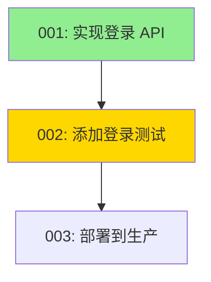

# Dual AI Collaboration - 使用教程（旧版）

> **旧版文档，不再更新。** 本文讲的是旧版 dual-ai-collab（代码在 `skill/`），其中的命令和路径不适用于当前的 foreman 技能。当前版本的说明见 [foreman/README.md](../../foreman/README.md)。

双 AI 协同开发系统，支持多模型路由、智能任务调度和完整的项目管理功能。

## 当前版本说明

新增可恢复的 `app-server` 后端及 `run complete --repair`，详见 [会话后端教程](./session-backend.md)。


- 模板命令加 `--add` 才会入库；`--depends-on 001` 指定依赖。不加 `--add` 仅输出 JSON。
- `select --smart` 使用与 `schedule` 相同的依赖和资源规则；基础 `select` 无需 psutil。
- `check-adapters` 检查本机命令；不检查账号与登录状态。
- Claude 原生协议须显式使用 `--sandbox provider-default`；Codex 沙箱模式下会跳过不兼容的 Claude 候选。
- 下方 DeepSeek 包装器路径仅为占位示例，需要替换或删除。完整协议说明见 [README](./README.md#新增命令与适配协议)。

## 目录

- [快速开始](#快速开始)
- [核心功能](#核心功能)
- [多模型适配器路由](#多模型适配器路由)
- [任务管理](#任务管理)
- [任务分析与可视化](#任务分析与可视化)
- [智能调度](#智能调度)
- [模板系统](#模板系统)
- [高级功能](#高级功能)

---

## 快速开始

### 1. 安装依赖

```bash
pip install psutil  # 用于系统资源监控
```

### 2. 初始化项目

```bash
cd your-project
python3 skill/scripts/cli.py init
```

运行 init 创建基础目录；配置文件需自行填写，history 在执行任务后创建。完整运行时结构：
```
.dual-ai-collab/
├── config.json              # 基础配置
├── model-routing.json       # 模型路由配置
├── logs/                    # 任务执行日志
├── history/                 # 执行历史记录
└── checkpoints/            # 检查点数据
```

### 3. 配置模型路由

编辑 `.dual-ai-collab/model-routing.json`：

```json
{
  "model_routing": {
    "quick": {
      "adapter": "deepseek-cli",
      "reason": "快速任务使用轻量模型"
    },
    "normal": {
      "adapter": "claude-cli",
      "reason": "常规任务使用平衡模型"
    },
    "heavy": {
      "adapter": "codex",
      "reason": "复杂任务使用强大模型"
    }
  },
  "fallback_chain": {
    "deepseek-cli": ["claude-cli", "codex"],
    "claude-cli": ["codex"],
    "codex": []
  },
  "adapter_commands": {
    "deepseek-cli": ["/path/to/your-codex-compatible-wrapper"],
    "claude-cli": ["claude"],
    "codex": ["codex", "exec", "-"]
  }
}
```

---

## 核心功能

### 任务生命周期

```bash
# 1. 创建任务板
python3 skill/scripts/cli.py init

# 2. 选择下一个任务
python3 skill/scripts/cli.py select

# 3. 启动任务（使用 adapter backend）
python3 skill/scripts/cli.py run start 001 "实现用户登录功能" --backend adapter

# 4. 检查任务状态
python3 skill/scripts/cli.py run status 001

# 5. 验证任务
python3 skill/scripts/cli.py verify extract 001
python3 skill/scripts/cli.py verify run 001

# 6. 仅在验收通过后更新任务状态
python3 skill/scripts/cli.py update 001 DONE
```

---

## 多模型适配器路由

### 执行级别

在任务板中设置执行级别：

```markdown
## 任务 #001: 实现用户登录

**执行级别**: quick    # 使用轻量模型 (deepseek-cli)
**执行级别**: normal   # 使用标准模型 (claude-cli)
**执行级别**: heavy    # 使用强大模型 (codex)
```

### 自定义适配器

任务板中可以直接指定适配器：

```markdown
**适配器**: claude-cli
**模型**: claude-sonnet-3.5
```

### 回退机制

当首选适配器不可用时，系统自动尝试回退链：

```
deepseek-cli 不可用 → 尝试 claude-cli → 尝试 codex
```

查看回退日志：

```bash
tail -f .dual-ai-collab/logs/task-001.log | grep fallback
```

### 适配器统计

```bash
# 查看任务执行历史（包含使用的适配器）
python3 skill/scripts/cli.py history
```

---

## 任务管理

### 创建任务板

手动创建 `planning/codex-tasks.md`：

```markdown
# Codex 任务板 - 用户认证系统

**创建时间**: 2024-01-15 10:00:00
**总任务数**: 3

---

## 任务 #001: 实现登录 API

**优先级**: P1
**状态**: OPEN
**执行级别**: normal
**依赖任务**: 无

### 任务描述
实现用户登录的 REST API 接口

### 验收标准
- [ ] API 返回正确的 JWT token
- [ ] 密码验证正确
- [ ] 错误处理完善

---

## 任务 #002: 添加登录测试

**优先级**: P2
**状态**: OPEN
**执行级别**: quick
**依赖任务**: 001

### 任务描述
为登录功能编写单元测试和集成测试
```

### 任务状态管理

```bash
# 更新任务状态
python3 skill/scripts/cli.py update 001 IN_PROGRESS
python3 skill/scripts/cli.py update 001 DONE

# 生成任务摘要
python3 skill/scripts/cli.py summary
```

### 智能选择下一个任务

```bash
# 选择最优先的任务
python3 skill/scripts/cli.py select

# 并行选择多个任务
python3 skill/scripts/cli.py select --parallel
```

---

## 任务分析与可视化

### 依赖图可视化

生成 Mermaid 格式的依赖图：

```bash
python3 skill/scripts/cli.py visualize --format mermaid -o deps.mmd
```

生成的图可以在 GitHub、GitLab 或任何支持 Mermaid 的工具中查看：



生成 Graphviz DOT 格式：

```bash
python3 skill/scripts/cli.py visualize --format dot -o deps.dot
dot -Tpng deps.dot -o deps.png
```

### 依赖分析

```bash
python3 skill/scripts/cli.py analyze
```

输出示例：

```
# 任务依赖分析报告

## 关键路径
最长依赖链: 001 → 002 → 003 → 005
关键路径长度: 4 个任务

## 可并行执行的任务
### 层级 0
可并行任务: 001, 004

### 层级 1
可并行任务: 002, 006

## ⚠️ 检测到循环依赖
1. 007 → 008 → 009 → 007
```

---

## 智能调度

### 调度分析报告

```bash
python3 skill/scripts/cli.py schedule
```

输出示例：

```
# 智能调度分析报告

## 系统资源状态
- CPU 使用率: 25.3%
- 内存使用率: 68.5%
- 可用内存: 8192 MB
- 磁盘使用率: 45.2%

## 完成时间估算
- 剩余任务: 12 个
- 串行执行预计: 18.5 小时
- 并行执行预计: 9.3 小时

## 推荐执行顺序（前 5 个）
1. 任务 #001: 修复登录 bug
   - 优先级: P0, 执行级别: quick
   - 调度分数: 120.5
   - 预计耗时: 3.0 分钟

2. 任务 #003: 实现支付接口
   - 优先级: P1, 执行级别: heavy
   - 调度分数: 85.2
   - 预计耗时: 15.0 分钟
```

### 资源感知调度

系统自动根据资源使用情况调整任务选择：

- **内存紧张**（>90%）：只执行轻量任务（quick）
- **CPU 繁忙**（>80%）：延迟重任务（heavy）
- **正常情况**：按优先级和依赖关系调度

---

## 模板系统

### 列出可用模板

```bash
python3 skill/scripts/cli.py templates list
```

内置模板：
- `feature` - 新功能开发
- `bugfix` - Bug 修复
- `refactor` - 代码重构
- `test` - 测试编写
- `docs` - 文档编写
- `optimization` - 性能优化

### 从模板创建任务

```bash
python3 skill/scripts/cli.py templates create feature 010 --add \
  --var feature_name="用户注册" \
  -o planning/task-010.json
```

生成的任务包含完整的结构：

```json
{
  "id": "010",
  "title": "实现用户注册功能",
  "priority": "P2",
  "status": "OPEN",
  "execution_level": "normal",
  "technical_requirements": [
    "设计清晰的 API 接口",
    "编写单元测试",
    "更新相关文档"
  ],
  "acceptance_criteria": [
    "功能按需求正常工作",
    "测试覆盖率达到 80% 以上",
    "代码通过 lint 检查"
  ]
}
```

### 从需求文档生成任务板

```bash
python3 skill/scripts/cli.py generate requirements.md -o planning/tasks.json
```

需求文档示例（`requirements.md`）：

```markdown
## 用户认证
- 实现用户注册功能
- 实现用户登录功能
- 添加密码重置功能

## 数据管理
- 设计数据库 schema
- 实现数据迁移脚本
```

自动生成任务板，每个功能点对应一个任务。

---

## 高级功能

### 执行历史追踪

```bash
# 查看所有任务的执行历史
python3 skill/scripts/cli.py history
```

输出示例：

```
# 任务执行历史报告

**总执行次数**: 45
**任务数量**: 12

## 任务 #001
- 执行次数: 3
- 成功: 2, 失败: 1
- 平均耗时: 245.3秒 (4.1分钟)
- 最快: 180.0秒
- 最慢: 320.5秒
- 最后执行: 2024-01-15T14:30:00+00:00
- 最后状态: success
- 使用适配器: claude-cli
```

### Checkpoint 系统

保存项目检查点：

```bash
# 保存当前状态
python3 skill/scripts/cli.py checkpoint-write developing \
  --current-task 005 \
  --total-tasks 20 \
  --completed-tasks 4

# 检查检查点状态
python3 skill/scripts/cli.py checkpoint-check
```

### 环境变量配置

通过环境变量快速切换配置：

```bash
# 覆盖适配器配置
# 路由请在 .dual-ai-collab/model-routing.json 中配置

# 设置默认 backend
export DUAL_AI_DEFAULT_BACKEND=adapter

# 启用调试日志
export DUAL_AI_LOG_LEVEL=DEBUG
```

### 结构化日志

所有操作都记录为结构化 JSON 日志：

```bash
cat .dual-ai-collab/logs/task-001.log | grep adapter_selected
```

输出：

```json
{
  "event": "adapter_selected",
  "level": "INFO",
  "task_num": "001",
  "adapter": "claude-cli",
  "execution_level": "normal",
  "reason": "常规任务使用平衡模型",
  "timestamp": "2024-01-15T14:30:00+00:00"
}
```

### 错误详情收集

任务失败时自动收集错误详情：

```bash
cat .dual-ai-collab/logs/task-001.error.json
```

包含：
- 退出码
- 错误消息
- 堆栈跟踪
- 系统环境信息

---

## 完整工作流示例

### 场景：开发用户认证系统

```bash
# 1. 初始化项目
python3 skill/scripts/cli.py init

# 2. 配置模型路由
cat > .dual-ai-collab/model-routing.json << 'EOF'
{
  "model_routing": {
    "quick": {"adapter": "deepseek-cli", "reason": "快速开发"},
    "normal": {"adapter": "claude-cli", "reason": "平衡性能"},
    "heavy": {"adapter": "codex", "reason": "复杂逻辑"}
  },
  "fallback_chain": {
    "deepseek-cli": ["claude-cli", "codex"],
    "claude-cli": ["codex"],
    "codex": []
  },
  "adapter_commands": {
    "deepseek-cli": ["/path/to/your-codex-compatible-wrapper"],
    "claude-cli": ["claude"],
    "codex": ["codex", "exec", "-"]
  }
}
EOF

# 3. 从模板创建任务
python3 skill/scripts/cli.py templates create feature 001 --add \
  --var feature_name="用户登录API"

python3 skill/scripts/cli.py templates create test 002 --add \
  --var module_name="登录功能"

python3 skill/scripts/cli.py templates create docs 003 --add \
  --var topic="用户认证API"

# 4. 生成依赖图
python3 skill/scripts/cli.py visualize -o docs/task-deps.mmd

# 5. 查看调度建议
python3 skill/scripts/cli.py schedule

# 6. 执行任务
python3 skill/scripts/cli.py select  # 选择最优任务
python3 skill/scripts/cli.py run start 001 "实现登录API" --backend adapter

# 7. 监控执行
watch -n 2 'python3 skill/scripts/cli.py run status 001'

# 8. 查看执行历史
python3 skill/scripts/cli.py history

# 9. 分析项目进度
python3 skill/scripts/cli.py analyze
python3 skill/scripts/cli.py summary
```

---

## 故障排查

### 适配器不可用

```bash
# 检查适配器命令是否在 PATH 中
which deepseek-cli claude codex

# 查看回退日志
grep "adapter_fallback" .dual-ai-collab/logs/task-*.log

# 手动测试适配器
deepseek-cli exec - < prompt.txt
```

### 任务卡住

```bash
# 检查进程状态
python3 skill/scripts/cli.py run status 001

# 查看详细日志
tail -f .dual-ai-collab/logs/task-001.log

# 强制终止
python3 skill/scripts/cli.py run stop 001
```

### 性能问题

```bash
# 查看系统资源
python3 skill/scripts/cli.py schedule | head -20

# 分析任务耗时
python3 skill/scripts/cli.py history | grep "平均耗时"

# 调整执行级别（在任务板中）
# heavy → normal 或 normal → quick
```

---

## 最佳实践

### 1. 执行级别选择

- **quick (3分钟)**：Bug 修复、简单功能、文档更新
- **normal (5分钟)**：标准功能开发、重构
- **heavy (10分钟)**：复杂逻辑、架构设计、性能优化

### 2. 依赖管理

- 明确声明任务依赖
- 避免循环依赖（使用 `analyze` 检测）
- 利用并行机会（查看 `analyze` 的层级输出）

### 3. 适配器选择

- 开发阶段：使用快速适配器（deepseek-cli）
- 关键功能：使用强大适配器（codex）
- 配置回退链确保可用性

### 4. 监控和分析

- 定期查看 `history` 了解任务耗时
- 使用 `schedule` 预估项目进度
- 通过 `visualize` 理解任务关系

---

## API 参考

完整的命令行参考：

```bash
# 任务管理
cli.py init                          # 初始化项目
cli.py select [--parallel]           # 选择任务
cli.py update TASK_NUM STATUS        # 更新状态
cli.py summary                       # 生成摘要

# 任务执行
cli.py run start TASK_NUM PROMPT [--backend adapter]
cli.py run status TASK_NUM
cli.py run stop TASK_NUM

# 分析和可视化
cli.py history                       # 执行历史
cli.py visualize [--format mermaid|dot] [-o FILE]
cli.py analyze                       # 依赖分析
cli.py schedule                      # 调度建议

# 模板系统
cli.py templates list
cli.py templates create TEMPLATE TASK_NUM [--var key=value]
cli.py generate SPEC_FILE [-o OUTPUT]

# 验证
cli.py verify extract TASK_NUM
cli.py verify run TASK_NUM
```

---

## 贡献

欢迎提交 Issue 和 Pull Request！

## 许可证

MIT License
